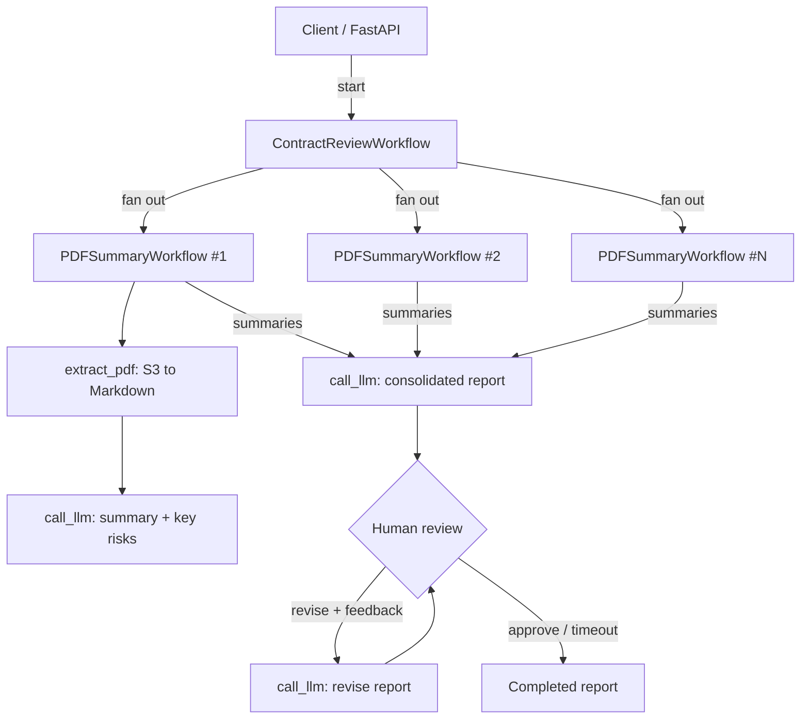

# AI Contract Review Pipeline

An AI-powered contract review system built on **Temporal** durable workflows. It extracts text from PDF contracts stored in S3, uses an LLM to summarize each contract and flag its key risks, combines everything into one consolidated risk report, and then pauses for a **human reviewer** to approve the report or request revisions.

## Features

- **Parallel processing**: one child workflow per contract, so a batch of PDFs is processed concurrently.
- **Fault tolerance**: if one contract fails, the rest of the batch continues. Retries with exponential backoff, timeouts and heartbeats make long PDF extractions and LLM calls resilient to failures.
- **LLM analysis**: per-contract summaries and risks, then a cross-contract synthesis covering overall risk level, compounding risks and recommended actions.
- **Human-in-the-loop review**: a reviewer can approve the report or send feedback for the LLM to revise it. Revision rounds are capped, and the review times out after 3 days.
- **Live progress**: Temporal queries expose the workflow's status and a preview of the report at any time.
- **REST API**: a FastAPI service starts reviews, checks status, assigns reviewers and submits decisions.

## Architecture



| Workflow status | Meaning |
|---|---|
| `extraction` | Child workflows are extracting and summarizing each PDF |
| `analyzing` | The LLM is synthesizing the consolidated report |
| `awaiting-review` | Waiting for a reviewer's decision |
| `revising` | The LLM is applying reviewer feedback |
| `completed` | Final report is available |

## Tech stack

Python · Temporal (Python SDK) · FastAPI · AWS S3 (boto3) · PyMuPDF / pymupdf4llm · OpenRouter (OpenAI-compatible API)

## Project structure

```
ai-contract-review/          # Temporal worker
  parent_workflow.py         # ContractReviewWorkflow: fan-out, synthesis, human review loop
  child_workflow.py          # PDFSummaryWorkflow: extract + summarize one contract
  activities.py              # extract_pdf (S3 -> Markdown), call_llm (OpenRouter)
  prompt.py                  # LLM prompts (summary, synthesis, revision)
  worker.py                  # Registers workflows and activities
client-app/                  # REST API
  main.py                    # FastAPI endpoints for starting and reviewing contracts
```

## Getting started

### Prerequisites
- Python 3.10+
- [Temporal CLI](https://docs.temporal.io/cli) to run a local Temporal server
- An S3 bucket (or an S3-compatible store such as MinIO) containing PDF files
- An [OpenRouter](https://openrouter.ai) API key

### 1. Start Temporal
```bash
temporal server start-dev
```
The Temporal Web UI will be available at http://localhost:8233.

### 2. Configure environment variables
Copy the example file in each folder and fill in your own values:
```bash
cp ai-contract-review/.env.example ai-contract-review/.env
cp client-app/.env.example client-app/.env
```
Both folders must use the same `TEMPORAL_CONTRACT_TASK_QUEUE`. Never commit `.env` files; they are listed in `.gitignore`.

### 3. Run the worker
```bash
cd ai-contract-review
pip install -r requirements.txt
python worker.py
```

### 4. Run the API
```bash
cd client-app
pip install -r requirements.txt
uvicorn main:app --reload
```
Interactive API docs: http://localhost:8000/docs

## API usage

| Method | Endpoint | Description |
|---|---|---|
| `POST` | `/contract-review/start` | Start a review for one or more S3 PDFs |
| `GET` | `/contract-review/{id}/status` | Execution status and live progress |
| `GET` | `/contract-review/{id}/report` | Current report, or the final result once completed |
| `POST` | `/contract-review/{id}/assign` | Assign a reviewer |
| `POST` | `/contract-review/{id}/revise` | Request a revision with feedback |
| `POST` | `/contract-review/{id}/approve` | Approve the report |

Example:
```bash
# Start a review
curl -X POST http://localhost:8000/contract-review/start \
  -H "Content-Type: application/json" \
  -d '{"s3_paths": ["s3://my-bucket/sample-contract-1.pdf", "s3://my-bucket/sample-contract-2.pdf"], "max_revisions": 2}'

# Request a revision
curl -X POST http://localhost:8000/contract-review/<workflow_id>/revise \
  -H "Content-Type: application/json" \
  -d '{"feedback": "Focus more on termination and liability clauses."}'

# Approve
curl -X POST http://localhost:8000/contract-review/<workflow_id>/approve
```

## Design notes

- **Why Temporal?** Contract review involves slow, failure-prone steps (large PDFs, LLM calls) and a human approval step that can take days. Temporal persists workflow state, so the process survives worker restarts and resumes exactly where it stopped.
- **Signals, updates and queries**: the reviewer is assigned with a *signal*. Decisions are sent as an *update* with a validator, so invalid input is rejected before it reaches workflow history. Progress is read with *queries*.
- **Robust LLM output**: responses are parsed with `json-repair` to tolerate slightly malformed JSON.
- **Data handling**: contract text is never written to logs, and downloaded PDFs are stored in temporary directories that are deleted after extraction.

## Disclaimer

This project is a technical demonstration. LLM output is not legal advice. Use only sample or synthetic contracts for testing.
